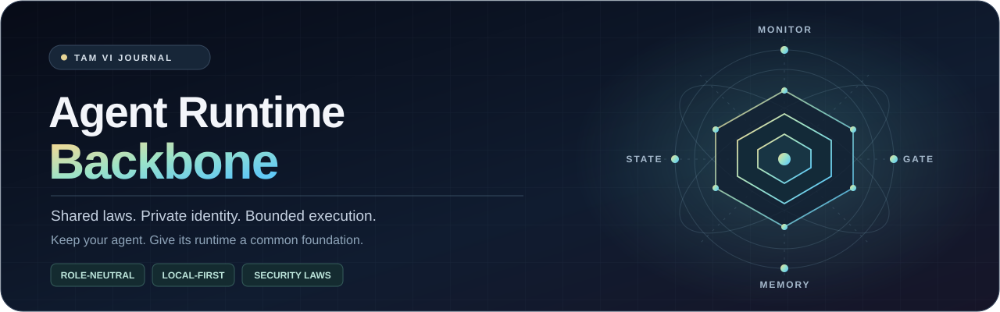

  

<h3 align="center">One shared operating backbone. Many independent agents.</h3>

  <a href="docs/STATUS.md"><b>v0.2.0a5</b></a> ·
  <a href="evidence/acceptance-0.2.0a5.json"><b>536/536 tests</b></a> ·
  <a href="evidence/acceptance-0.2.0a5.json"><b>19/19 isolated mTLS tests</b></a> ·
  <a href="COPYRIGHT.md"><b>Copyright &amp; attribution</b></a>

  <a href="docs/INSTALL.md">Install</a> &nbsp;·&nbsp;
  <a href="AGENTS.md">AI installer</a> &nbsp;·&nbsp;
  <a href="docs/SHARED-BACKBONE.md">Architecture</a> &nbsp;·&nbsp;
  <a href="scaffold/canonical_runtime_spine.md">Canonical laws</a> &nbsp;·&nbsp;
  <a href="docs/STATUS.md">Evidence &amp; status</a>

---

## The idea

An agent should not have to become another agent to gain a more disciplined
runtime. Agent Runtime Backbone extracts shared operating mechanisms from an
existing local agent into a role-neutral foundation. Keep the host, model,
inference loop, private identity, role and memory you already have.

**A shared foundation, not a shared identity.** The backbone is not a new LLM,
a replacement inference engine or an MCP-only service.

| Layer | Purpose |
|---|---|
| **Canonical laws** | Establish common authority, verification and safety boundaries. |
| **Monitor · Mirror · Effort** | Observe operational state, manage effort and preserve uncertainty. |
| **State · Memory · Sleep/Wake** | Keep bounded candidate context and continuity across turns and pauses. |
| **Gate · Workers · Verification** | Separate proposed actions, execution, evidence and final claims. |
| **Security** | Guard secrets and data, constrain execution, require actual network enforcement. |

## Architecture

<pre>
     Existing agent host + LLM
                │
    Shared runtime / canonical laws
                │
   ┌────────────┼─────────────┐
   │            │             │
 Monitor     State &amp;       Gate &amp;
 / Effort    Memory        Verification
   │            │             │
   └────────────┼─────────────┘
                │
    Approved execution boundaries
                │
       Optional extensions

   Private per-agent identity, role,
   memory and work state stay separate.
</pre>

The host owns its existing inference and action loop. A packaged helper is
not proof that a host actually invokes it. Read the
[shared backbone guide](docs/SHARED-BACKBONE.md) and
[source-parity audit](docs/SOURCE-PARITY.md) for the exact integration scope.

## Install without rebuilding your agent

Use a dedicated Python 3.11+ environment on macOS or Linux. Read the
[installation guide](docs/INSTALL.md) before applying changes to an existing
agent. Stage the neutral templates in [scaffold/](scaffold/); preserve existing
identity, role and memory.

### For AI-assisted installation

Ask your AI installer to read [AGENTS.md](AGENTS.md) and
[docs/INSTALL.md](docs/INSTALL.md) first. The installer must inspect the
target host, explain its plan, and obtain the owner's module choices.
No automatic replacement of a working agent or global security changes.

| Optional module | Why choose it? | Requirements / limits |
|---|---|---|
| Docker worker sandbox | OS-enforced isolation for registered offline workers | Qualified engine and reviewed local image; resource overhead; not whole-host isolation. |
| mTLS read gateway | Authenticated, resource-scoped read access | Approved gateway, certificates and maintenance; not IP anonymity. |
| MCP server + adapter | Optional transport for registered execution tools | Additional process and host registration; not the core. |
| SQLite activity ledger | Local audit metadata and interruption recovery | Separate local database; not semantic memory. |

**Default: all four off.** They ship as source but are not automatically
configured, started or registered. The owner must explicitly select each.
The bundled MCP executable requires its ledger; useful MCP execution also
requires a configured Docker or registered read-gateway backend. Direct
offline execution does not require MCP or the new ledger. Direct Python
service integration can omit the ledger. Never silently enable a declined
prerequisite.

### Memory is instance-owned

The core does not include a private memory database, seeds or credentials.
Reuse the host's existing memory integration. The supplied cue adapter expects
a separately available, compatible ConsumerMemory API; see
[Memory binding](docs/INSTALL.md#memory-binding). Do not assume that the
maintainer's separate implementation is publicly downloadable.

## Security is a law, not an optional switch

[Canonical Runtime Spine §8](scaffold/canonical_runtime_spine.md#8-mandatory-network-and-data-boundary)
and the [boot adapter](scaffold/SOUL.md) require authorized network access,
protection of private data and fail-closed operation even when every optional
module is declined. If an operation requires protection and that boundary is
not available or verified, do not execute it. Never fall back to an
unconfined route.

| Capability | Verified scope |
|---|---|
| Registered offline Docker workers | Bounded isolation and role/operation denial |
| Registered mTLS read gateway | Authorized resources, certificate checks and unavailable-gateway failure |
| Secret and data guards | Pattern-limited checks and scoped worker handling |
| Network containment lab | Synthetic isolated topology; direct TCP/UDP denied, IPv4/IPv6 route checks, child-process checks and relay failure |
| Whole-agent / live browser IP protection | **Not yet qualified** |

The [containment lab](docs/NETWORK-CONTAINMENT-FIXTURE.md) is not a production
browser backend or proof of public IP privacy. A gateway can observe its
client's source IP. Actual protected connected workloads require their own
approved and independently qualified enforcement/egress environment. No
anonymity guarantee or permission to evade service restrictions.

## Release evidence

**v0.2.0a5 — independently reviewed shared scaffold.** The reviewed package
is based on commit 96751dd. Author acceptance and independent Linux
reproduction are recorded separately.

| Check | Result |
|---|---|
| Author regression suite (macOS) | 536/536 |
| Independent regression suite (Linux) | 536/536 |
| Independently built wheel | Identical SHA-256 |
| Isolated mTLS tests (author) | 19/19 |
| SDK / bounded Docker / ledger checks (author) | Pass |
| Extended network lab (author) | Pass, synthetic scope only |

Read the [acceptance receipt](evidence/acceptance-0.2.0a5.json),
[network lab receipt](evidence/containment-fixture.json) and
[release status](docs/STATUS.md). The reviewer did not independently access
the original private checkout. This evidence does not certify an entire
agent, model, live account or production browser. Worker output remains
candidate evidence; gate decisions and logs are not independent factual proof.

## Project map

| Path | Contents |
|---|---|
| [scaffold/](scaffold/) | Canonical spine, boot templates and shared specifications |
| [runtime/](runtime/) | Portable mechanisms, boundaries and optional execution helpers |
| [docs/](docs/) | Installation, architecture, review and security documentation |
| [tests/](tests/) | Regression and source-parity fixtures |
| [scripts/](scripts/) | Reproducible acceptance and isolated lab utilities |
| [evidence/](evidence/) | Scoped, recorded verification results |

## Copyright & attribution

Copyright © 2026 **Tam Vi Journal**, for its original contributions, where
applicable. See [COPYRIGHT.md](COPYRIGHT.md) for the rights boundary and
third-party notices. The bundled governance library retains its existing
[MIT license](licenses/agent-audit-kit-MIT.txt). Other source material is not
automatically relicensed by publication. No repository-wide open-source
license or formal copyright-registration certificate is asserted.

No private identity, databases, credentials, live configuration or original
private Git history is distributed.

TAM VI JOURNAL · AGENT RUNTIME BACKBONE

